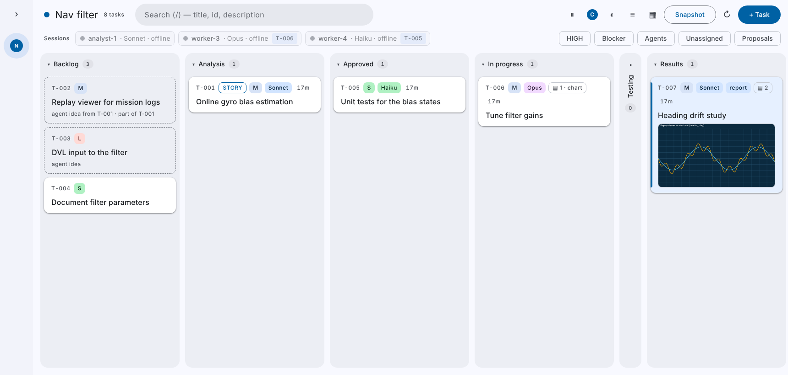
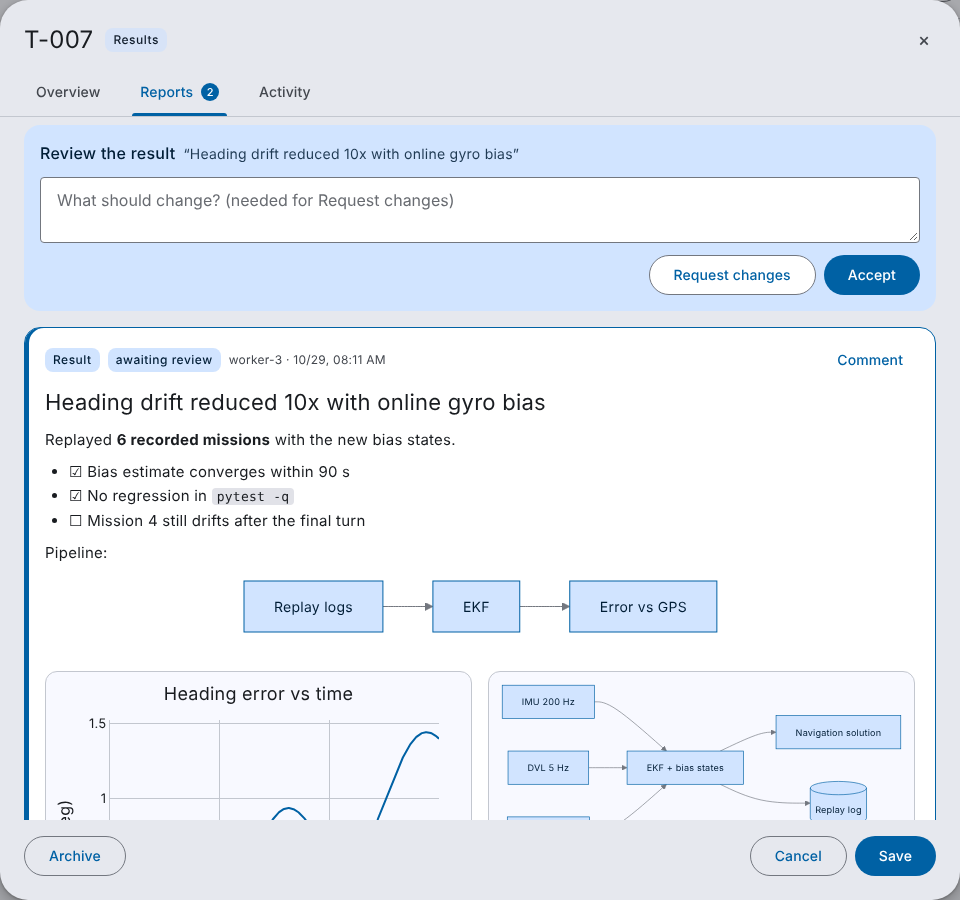
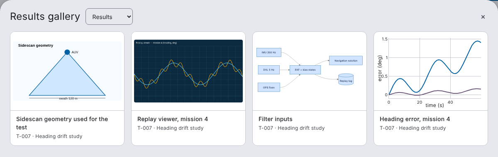
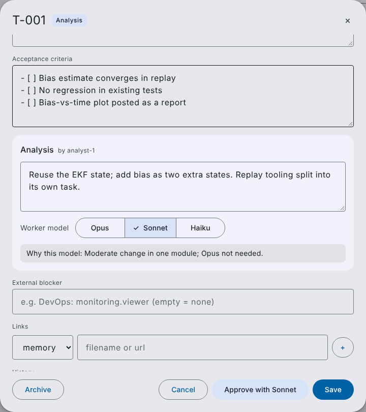
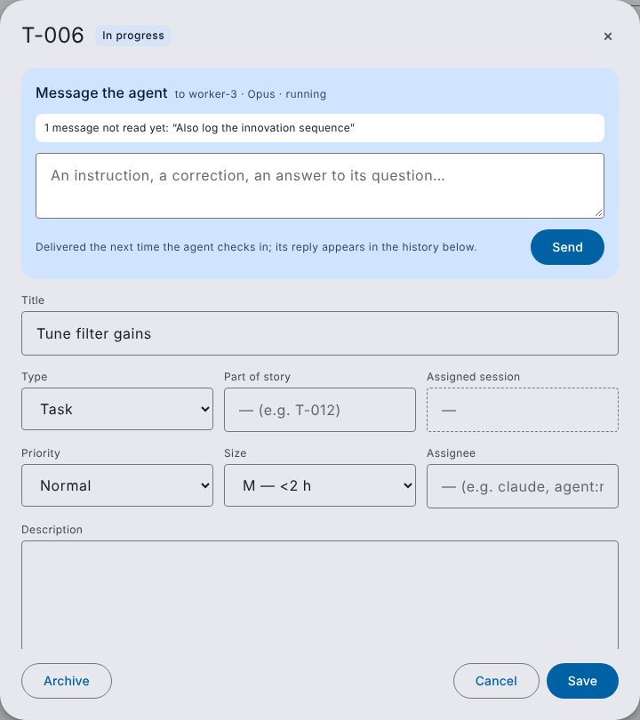
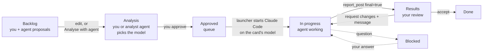

# agentic-kanban — Mission Board

> A local-first kanban board where you and your AI coding agents work the same
> backlog. You approve the work and pick each card's model; agents claim it,
> report back, propose follow-ups and answer your messages — all over MCP.

[](LICENSE)
[](https://www.python.org/)



agentic-kanban is a fork of [nerkoman/agent-kanban](https://github.com/nerkoman/agent-kanban)
(SQLite + FastAPI + MCP, MIT) reworked into a **mission board for agents**:

- **One shared backlog.** You add tasks and user stories; agents propose them too
  (marked as proposals, never auto-approved).
- **Analysis before work.** A card is refined in the Analysis column — by you or by
  an analyst agent — and gets its **worker model: Opus, Sonnet or Haiku**.
- **Approval starts an agent.** Approving a card launches Claude Code on that card's
  model, in the project's repo, with the card as its brief.
- **Reports with figures.** Agents post progress and result reports with **Mermaid
  diagrams, Plotly charts, snapshots (PNG/JPEG/GIF/WebP) and SVG drawings**. You
  comment on a report or on one figure, and the comment goes to the agent.
- **Results is the review gate.** A final report moves the card to Results; you
  **Accept** (→ Done) or **Request changes** (→ back to the agent with your note).
- **Live view of every agent.** A sessions strip shows each agent session — model,
  status, the card it holds — and cards an agent is writing on light up.
- **Talk to any agent.** Message the agent on a card, or any session directly. The
  agent gets it on its next tool call, when it tries to stop, or at once through a
  Claude Code **channel**, and replies in the card's history. A message to an agent
  that has finished can **resume** its session.
- **Analyst agent.** *Analyse with agent* sends a card to an analyst session (on the
  project's analyst model) that writes the analysis, splits the work and picks the
  worker model.
- **Material 3 UI** in light and dark, drag-and-drop, multi-project, search and filters.

| | |
|---|---|
|  |  |
| A result report: review bar, Markdown with a Mermaid fence, Plotly and SVG figures | Results gallery across the project's cards |
|  |  |
| Analysis: story, criteria, notes, worker model and the analyst's reason | Message the agent working on a card |

---

## Contents

- [How the workflow runs](#how-the-workflow-runs)
- [Quickstart](#quickstart)
- [The board](#the-board)
- [Agents and MCP](#agents-and-mcp)
- [Reports and figures](#reports-and-figures)
- [Messages to agents](#messages-to-agents)
- [Sessions](#sessions)
- [Starting agents (launcher): work, analyse, resume](#starting-agents-launcher-work-analyse-resume)
- [REST API](#rest-api)
- [Automation: rules, inbox, webhooks](#automation-rules-inbox-webhooks)
- [Configuration](#configuration)
- [Using a Claude subscription](#using-a-claude-subscription)
- [Upgrading from agent-kanban](#upgrading-from-agent-kanban)
- [Project layout](#project-layout) · [Maintenance](#maintenance) · [Roadmap](#roadmap) · [License](#license)

---

## How the workflow runs



| Column | Who moves cards in | What happens there |
|---|---|---|
| **Backlog** | you, agents (`task_propose`) | new tasks and user stories; agent proposals show dashed |
| **Analysis** | you, *Analyse with agent* | scope, story, acceptance criteria, analysis notes, worker model |
| **Approved** | you | queue: the launcher starts an agent for each card (model filled from the project default if none was picked) |
| **In progress** | agent (`kanban_pull`) | the agent works; the card shows *writing* while it does |
| *Testing* | agent | optional verification step, folded away by default |
| **Results** | agent (`report_post final=true`) | the result report, waiting for your review |
| **Done** | you (*Accept*) | accepted |
| **Blocked** / **Cancelled** | anyone / you | waiting on a question or dependency / dropped |

By default agents may not move cards into **Analysis, Approved or Done**
(`KANBAN_MCP_HUMAN_ONLY`): refining, approving and accepting stay human decisions.

## Quickstart

**One line** — install into `~/agentic-kanban`, connect your repo, start the board:

```bash
curl -fsSL https://raw.githubusercontent.com/zepinto/agentic-kanban/main/scripts/setup.sh | bash -s -- ~/code/myapp --agents
```

[`scripts/setup.sh`](scripts/setup.sh) clones the board (or updates an existing
checkout), installs uv if it is missing, installs the dependencies and downloads Mermaid
and Plotly.js. It then creates a project for `~/code/myapp` (the id comes from the folder
name), connects the repo (`.mcp.json`, `CLAUDE.md`) and adds the message hook to the
repo's `.claude/settings.json`. Finally it starts the board on http://localhost:7777.
`--agents` adds the three launcher rules (worker on approval, analyst, resume on
message); leave it out to drive Claude Code yourself. Other options: `--project SLUG`,
`--model opus|sonnet|haiku`, `--analyst-model …`, `--channel`, `--dir PATH`,
`--port N`, `--no-hooks`, `--no-vendor`, `--no-start`. With no repo it only installs and
starts the board. Re-running it is safe: nothing is added twice.

To connect another repo later, run it again with that repo and `--no-start` (the board
keeps running), or use the connect helper below.

**By hand.** Requirements: Python 3.12+, macOS or Linux (Windows via WSL2), and
[uv](https://docs.astral.sh/uv/) (`curl -LsSf https://astral.sh/uv/install.sh | sh`).

```bash
git clone https://github.com/zepinto/agentic-kanban.git
cd agentic-kanban
uv run python -m kanban_ui          # creates .venv, installs, serves http://localhost:7777
```

Then, to let agents work a project:

1. **Create a project** (`+ New project`) and set its **project directory** — the repo
   agents work in — and its default worker model.
2. **Connect Claude Code** in that repo (ticked by default when creating the project,
   or run `python -m kanban_mcp.connect ~/code/myapp --project myapp`). This writes
   `.mcp.json` with the board's MCP server and a rules block in `CLAUDE.md`.
3. **Turn on agent starts**: add the launcher rule to `kanban_data/rules.json`
   (see [launcher](#starting-agents-launcher-work-analyse-resume)).
4. Add a card, refine it in Analysis, press **Approve with Sonnet** — an agent takes it.

Any Claude Code session you start yourself in the connected repo also joins the board:
it appears in the sessions strip on its first change and can claim cards, propose work
and receive your messages.

More detail: [QUICKSTART.md](QUICKSTART.md) · [docs/INTEGRATION.md](docs/INTEGRATION.md) ·
[docs/USECASES.md](docs/USECASES.md).

## The board

- **Cards** carry: type (task / **story**), worker model chip, size, priority, assignee,
  age in column, and lines for *agent idea from T-…* and *part of T-…* (stories group
  their tasks through `parent_id`).
- **Attention states**: a card an agent is working on now has a live outline and a
  *writing* chip; *asks you* when its agent waits for an answer; Results cards are tinted
  with a *report* chip; Testing cards get a tertiary marker.
- **Card thumbnails**: a card with reports shows its latest figure (snapshots and SVGs
  first) and a report count; Results cards show *awaiting review* / *changes
  requested*.
- **Card dialog**, in three tabs:
  - **Overview** — message the agent, title, type and user story (*As … I want … so
    that …*), parent story, assigned session, priority/size/assignee, description,
    acceptance criteria (`- [ ]` checklist), **Analysis** (notes, who analysed, the
    Opus/Sonnet/Haiku picker, the analyst's rationale, *Analyse with agent*), blocker,
    links. Actions: *To Analysis*, *Approve with &lt;model&gt;*, Archive.
  - **Reports** — every report, newest first, with the review bar on a pending result,
    figures, and comment threads on reports and figures.
  - **Activity** — moves, comments, reports, messages and agent replies.
- **Results gallery** (`g`, or the toolbar button): every figure from the project's
  result reports (or all reports), each linking back to its card; click a figure for a
  full-size view.
- **Sessions strip** above the board; click a session to message it.
- **Filters**: HIGH, Blocker, Agents, Unassigned, Proposals; search with `/`.
- **Keyboard**: `n` new card, `/` search, `g` gallery, `r` refresh, `d` density, `t` light/dark,
  `\` sidebar, `Esc` close.
- **Projects**: many projects in one database, URL-routed (`/p/{slug}`, card links
  `/t/{id}`), each with its own directory, default worker model and analyst model.
- **Look**: Material Design 3 — tonal colour roles, Roboto Flex, M3 shapes, elevation
  and state layers — in light and dark. Tokens live at the top of
  `kanban_ui/static/styles.css` under M3 role names, so another seed colour from the
  Material Theme Builder can be pasted in.

## Agents and MCP

The MCP server runs over **stdio** for Claude Code / Cline (`python -m kanban_mcp`,
written into `.mcp.json` by the connect helper) and over **streamable HTTP** at
`http://localhost:7777/mcp` (SSE at `/sse`) for Cursor, newer Cline, Open WebUI and the
MCP Inspector. Tool arguments are strict: a wrong name (`project=` instead of
`project_id=`) is an error with a suggestion, never a silently dropped value.

| Tool | What it does |
|---|---|
| `kanban_columns` | column model and who owns each column |
| `kanban_projects`, `kanban_board`, `kanban_list`, `kanban_search`, `kanban_get`, `kanban_history` | read the board |
| `kanban_my_active` | this agent's cards in in_progress / testing |
| `kanban_pull` | atomically claim an approved card → in_progress, bound to this session |
| `kanban_move` | move a card (finished work → `results`) with a comment; `expected_from` guards against stale moves |
| `kanban_comment`, `kanban_link`, `kanban_blockers`, `kanban_assign` | progress notes, links (pr/file/url/plan/memory), dependencies, hand-offs |
| `kanban_create`, `kanban_update` | create / edit cards, including story fields and parent |
| `task_propose` | propose a task or user story; always lands in Backlog as the agent's proposal, linked to the card it came from |
| `session_register`, `session_status` | name this session; report active / idle / waiting_input / finished, current card and a note |
| `inbox_get` | read your messages (optionally wait up to 60 s for one) |
| `inbox_reply` | answer a message; the reply shows in the card's history |
| `report_post` | progress or (`final=true`) result report with Markdown and figures; a final report moves the card to Results |
| `analysis_submit` | the analyst's write-up: analysis notes, worker model and reason, acceptance criteria, story fields, sub-cards |

Every tool response includes `inbox_pending` (and a hint) while the agent has unread
messages, so it notices whatever it is doing.

## Reports and figures

An agent reports with `report_post`: a title, a Markdown summary and any number of
figures (up to 24, 20 MB each by default). Each figure type has its own renderer:

| `type` | Body | Shown as |
|---|---|---|
| `mermaid` | `source`: Mermaid text (flowchart, sequence, gantt, class, state, …) | diagram drawn in the browser with the board's colours (strict security level: no HTML labels, no click handlers) |
| `plotly` | `figure`: a Plotly figure dict, or `path` to `fig.write_json()` output | interactive Plotly.js chart, themed to light/dark, legend moved under narrow plots |
| `snapshot` | `path` or `data_base64` of a PNG / JPEG / GIF / WebP (type checked from the bytes) | image; click for full size |
| `svg` | `path` or `source` of any SVG drawing | image (``, so scripts in the SVG never run; also served with a sandboxing CSP) |
| `file` | `path` or `data_base64`, optional `filename` | download link (CSV, logs, notebooks, …) |

```python
report_post(
    title="Heading drift reduced 10x with online gyro bias",
    final=True,
    summary_md="Replayed **6 missions**.\n\n- [x] converges within 90 s\n- [ ] mission 4 drifts",
    assets=[
        {"type": "plotly", "path": "out/heading_error.json", "caption": "Heading error, mission 4"},
        {"type": "snapshot", "path": "out/replay.png", "caption": "Replay viewer"},
        {"type": "mermaid", "source": "graph LR; IMU-->EKF; DVL-->EKF", "caption": "Filter inputs"},
        {"type": "svg", "path": "docs/geometry.svg", "caption": "Sidescan geometry"},
    ],
)
```

Paths resolve against the agent's project directory. ` ```mermaid ` and ` ```plotly `
(JSON) fences inside the Markdown are drawn too. Figure bodies are stored once, by
SHA-256, under `KANBAN_ASSETS_DIR` (default `kanban_assets/` next to the database) and
served immutable from `/api/assets/{id}`. Mermaid and Plotly.js load lazily from
`kanban_ui/static/vendor/` when present (`scripts/vendor_libs.sh` downloads them, for
offline use) and otherwise from the jsDelivr CDN.

**Review.** The newest result report is the one under review (older ones become
*superseded*). **Accept** marks it accepted and moves the card to Done; **Request
changes** needs a note, sends it to the agent as feedback anchored to that report, and
moves the card back to In progress. Only people can review.

**Comments on figures.** Every report and figure has a *Comment* button. The comment
goes to the session that posted the report, tagged *on figure "…" in report "…"*, and
the agent's reply threads under it.

## Messages to agents

Send from the card dialog (**Message the agent**) or by clicking a session chip.

- A message **about a card** goes to the agent bound to it (the one that claimed it),
  else a live session on it, else the agent that proposed it. With no agent attached
  yet it **waits** and is delivered to whichever agent claims the card.
- A message **to a session** goes straight to it (optionally tagged with a card).
- A comment **on a report or figure** goes to the session that posted it.
- Messages and replies are written to the card's history; the composer shows unread
  ones, and session chips show an ✉ count.

How the agent receives them:

1. **Piggyback** — any MCP tool call returns `inbox_pending`; the agent calls `inbox_get`.
2. **Stop hook** — `python -m kanban_mcp.hook` blocks the agent from ending its turn
   while messages are waiting and hands them over. The launcher installs it for every
   run; for your own sessions add it to `.claude/settings.json`:

   ```json
   {"hooks": {
     "Stop":             [{"hooks": [{"type": "command", "command": "KANBAN_DB=/path/to/agentic-kanban/tasks.db PYTHONPATH=/path/to/agentic-kanban /path/to/agentic-kanban/.venv/bin/python -m kanban_mcp.hook"}]}],
     "UserPromptSubmit": [{"hooks": [{"type": "command", "command": "KANBAN_DB=/path/to/agentic-kanban/tasks.db PYTHONPATH=/path/to/agentic-kanban /path/to/agentic-kanban/.venv/bin/python -m kanban_mcp.hook"}]}]
   }}
   ```

   `PYTHONPATH` is needed because the hook runs in your repo, not in the board's folder.
   The hook reads `KANBAN_DB` when set, else asks the board at `KANBAN_URL`.
   `scripts/setup.sh` writes this for you.
3. **Waiting for an answer** — an agent that asked you something calls
   `session_status(status="waiting_input")` and `inbox_get(wait_seconds=60)`.
4. **Channel push** (Claude Code channels, research preview) — with
   `KANBAN_MCP_CHANNEL=1` on the MCP server, a message reaches an interactive session
   within seconds, even while it sits idle at the prompt, as
   `<channel source="agent-kanban" input_id="…" kind="…" sender="…" task_id="…">`.
   Turn it on with `python -m kanban_mcp.connect ~/code/myapp --project myapp --channel`
   and start Claude Code with
   `claude --dangerously-load-development-channels server:agent-kanban` (custom channels
   are not on the research-preview allowlist; Team and Enterprise organisations must
   enable channels). Claude Code drops channel events silently when the channel isn't
   loaded, so a pushed message stays unread until the agent answers it with
   `inbox_reply`: routes 1–2 still catch anything the channel lost. Only messages from
   people are pushed (`KANBAN_CHANNEL_FROM=any` adds other agents'). An open channel
   also keeps the session shown live.
5. **Resume** — a message to a card whose agent is no longer running can restart that
   agent's session with the message (`--resume`), through a `task_event` rule; see the
   launcher.

## Sessions

A session is one Claude Code process. Under Claude Code the MCP server knows its
`CLAUDE_CODE_SESSION_ID`, so the session **registers itself on its first change** and
every change is a heartbeat; `session_register` only sets a nicer name
(e.g. `analyst-1`). The strip shows name, model, status (running / idle / asking /
offline — silent for 15 min), the card it holds, and unread messages. Launchers and
hooks can use `POST /api/sessions` and `POST /api/sessions/{id}/status`.

## Starting agents (launcher): work, analyse, resume

[`examples/agent-launcher/launch-claude.sh`](examples/agent-launcher/README.md) runs
Claude Code headless (`claude -p`) for a card, in one of three modes:
`launch-claude.sh <task_id> <project_id> [work|analyse|resume]`. The usual setup is
three rules. A worker when a card lands in Approved:

```json
{
  "rules": [
    {
      "name": "Agent on approval",
      "trigger": {"type": "task_moved", "to_status": "approved", "project_id": "myapp"},
      "action": {
        "type": "run_command",
        "cmd": "/abs/path/to/agentic-kanban/examples/agent-launcher/launch-claude.sh",
        "args": ["{task_id}", "{project_id}"],
        "max_concurrent": 2,
        "max_runs": 3
      }
    }
  ]
}
```

An analyst when you press *Analyse with agent*, and a resume when you message a card
whose agent is offline (both are `task_event` rules):

```json
{"name": "Analyst", "trigger": {"type": "task_event", "action": "analysis_requested"},
 "action": {"type": "run_command", "cmd": "/abs/path/to/launch-claude.sh",
            "args": ["{task_id}", "{project_id}", "analyse"], "max_concurrent": 1}},
{"name": "Resume on message", "trigger": {"type": "task_event", "action": "message", "agent": "offline"},
 "action": {"type": "run_command", "cmd": "/abs/path/to/launch-claude.sh",
            "args": ["{task_id}", "{project_id}", "resume"], "max_runs": 5}}
```

- **work** uses the card's `agent_model` and ends with `report_post(final=true)`.
- **analyse** runs on the project's analyst model with read-only tools
  (`KANBAN_ANALYST_ALLOWED_TOOLS`, default `Read Grep Glob`) and must end with
  `analysis_submit`; the card stays in Analysis for you to approve.
- **resume** continues the card's last session (`--resume <session>`) and has it read
  and answer your messages (`inbox_get`, `inbox_reply`), posting a new result if you
  asked for changes.

In work mode the launcher uses the card's `agent_model` (`--model opus|sonnet|haiku`), runs in the project
directory with the board's MCP server passed explicitly, `--permission-mode dontAsk`
and an allow-list of tools, installs the message Stop hook, puts the story, acceptance
criteria and analysis notes in the prompt, enforces a hard timeout, and blocks the card
with the reason if the agent stops without finishing. Optional `KANBAN_GATE_CMD`
(e.g. `pytest -q`) must pass before a card stays in Results. Per-card logs:
`~/Library/Logs/agent-kanban/runs/T-XXX/`.

## REST API

Interactive docs at `http://localhost:7777/docs`; OpenAPI at `/openapi.json`
(static copy in [`docs/openapi.yaml`](docs/openapi.yaml)). Highlights:

| Endpoint | Purpose |
|---|---|
| `GET /api/board?project=` | columns (with `hidden`, `hint`) and cards, incl. `activity` (`live` / `waiting`) |
| `POST /api/tasks` · `PATCH /api/tasks/{id}` | create / edit, incl. `type`, `story_*`, `parent_id`, `agent_model`, `analysis_md`, `model_rationale` |
| `POST /api/tasks/{id}/move` | move; approving fills `agent_model` from the project default |
| `POST /api/tasks/{id}/messages` · `GET …/messages` | message the card's agent (optionally on a `report_id` / `asset_id`); messages + the attached agent |
| `POST /api/tasks/{id}/analyse` | send the card to Analysis for an analyst agent (people only) |
| `POST /api/tasks/{id}/reports` · `GET …/reports` | post a report (assets as `text`, `figure` or `data_base64`) / list a card's reports |
| `GET /api/reports/{id}` · `POST /api/reports/{id}/review` | one report / accept or request changes (people only) |
| `GET /api/reports?project=&kind=result` | gallery: figures across a project |
| `GET /api/assets/{id}` | a figure's body (`?download=true` for an attachment) |
| `GET /api/sessions?project=` | sessions with `pending_inputs` |
| `POST /api/sessions` · `POST /api/sessions/{id}/status` | register / heartbeat a session |
| `POST /api/sessions/{id}/messages` · `GET /api/sessions/{id}/inbox` | message a session / read its unread messages (marks them read) |
| `POST /api/projects` · `PATCH /api/projects/{id}` | projects, incl. `default_model`, `analyst_model`, `path` |

Scripts name themselves in history with an `X-Kanban-Actor` header. HTTP MCP clients
are treated as agents: their cards are proposals and the human-only columns apply.

## Automation: rules, inbox, webhooks

- **Rules** (`kanban_data/rules.json`, hot-reloaded): triggers `task_idle`,
  `task_count_in_status`, `task_moved`, `blockers_done`, and `task_event` (`action`:
  `analysis_requested`, `message`, `comment`, `report`, `reply`; optional
  `agent: offline|live` — whether an agent session is on the card — and
  `from: human|any`, default human); actions `move_to`,
  `add_comment`, `set_priority`, `run_command`, `archive`, `assign`; `wip_limit` caps a
  lane; pause from the top bar. Status names are normalised, so pre-v0.3 names
  (`uat`, `analyst`) keep working.
- **Inbox folder**: drop a `.md` into `kanban_data/inbox/` → a card within seconds.
- **PLAN.md import**: `## Section` headings → columns, `- [ ]` lines → cards (one-shot).
- **Webhooks** (`kanban_data/webhooks.json`): POST to Slack / Telegram / any URL on
  `task_created` / `task_moved` / `task_commented` / `task_updated` /
  `task_reported` / `task_messaged` / `analysis_requested`.

## Configuration

| Variable | Default | Purpose |
|---|---|---|
| `KANBAN_HOST` / `KANBAN_PORT` | `127.0.0.1` / `7777` | bind address and port |
| `KANBAN_DB` | `<repo>/tasks.db` | SQLite file shared by web server, MCP server, hook and CLI |
| `KANBAN_ACTOR` | `user` (web) / `claude` (MCP) | name written to history; also the session's display name |
| `KANBAN_DEFAULT_PROJECT_ID` / `_NAME` / `_COLOR` | `default` / `Default` / `#0061A4` | seed project on first launch |
| `KANBAN_DEFAULT_MODEL` | `sonnet` | default worker model for new projects |
| `KANBAN_SESSION_OFFLINE_AFTER` | `900` | seconds without a heartbeat before a session shows offline |
| `KANBAN_PROJECT_ID` | — | MCP: this agent's project (default for creates, scope of reads) |
| `KANBAN_MCP_HUMAN_ONLY` | `analysis,approved,done` | MCP: columns agents may not move or create cards into (`""` allows all) |
| `KANBAN_URL` | `http://localhost:7777` | MCP and hook: board URL |
| `KANBAN_AGENT_MODEL` / `KANBAN_STARTED_BY` | — | set by the launcher: model and `hub` marker shown on the session |
| `CLAUDE_CODE_SESSION_ID` | set by Claude Code | the session id the MCP server registers |
| `KANBAN_MCP_CHANNEL` | off | MCP: push messages into the session as Claude Code channel events |
| `KANBAN_CHANNEL_FROM` / `KANBAN_CHANNEL_POLL` | `human` / `2` | channel: whose messages to push / how often to look (s) |
| `KANBAN_SESSION_ID` | — | MCP: session id to use when Claude Code provides none (channel mode) |
| `KANBAN_ASSETS_DIR` | `kanban_assets/` next to the DB | where report figures are stored |
| `KANBAN_ASSET_MAX_BYTES` / `KANBAN_ASSETS_PER_REPORT` | `20971520` / `24` | figure size and count limits |
| `KANBAN_INBOX_DIR`, `KANBAN_RULES_FILE`, `KANBAN_WEBHOOKS_FILE`, `KANBAN_LOG_DIR` | under `kanban_data/` | automation files |
| `KANBAN_AUTOMATION_INTERVAL` / `KANBAN_INBOX_INTERVAL` / `KANBAN_EVENTS_INTERVAL` | `60` / `5` / `1` | polling intervals (s) |
| `KANBAN_EVENTS_QUIET_ACTORS` | `plan-import,maintenance` | bulk writers that don't fire rules or webhooks |
| `KANBAN_RULE_LOOP_LIMIT` | `5` | a reactive rule fires on one card at most N times per 10 min |
| `KANBAN_CORS_ORIGINS` | — | comma-separated origins for remote clients |

Launcher variables (`AGENT_TIMEOUT_SEC`, `CLAUDE_BIN`, `KANBAN_PERMISSION_MODE`,
`KANBAN_ALLOWED_TOOLS`, `KANBAN_ANALYST_ALLOWED_TOOLS`, `KANBAN_GATE_CMD`,
`CLAUDE_MODEL_S/M/L` fallback, …) are listed
in [examples/agent-launcher/README.md](examples/agent-launcher/README.md).

## Using a Claude subscription

The launcher runs the `claude` CLI, which uses whatever login it has — an API key or a
Pro/Max plan. On a subscription, headless `claude -p` and Agent SDK runs draw from the
plan's separate Agent SDK credit, and Opus uses it fastest; keep Sonnet as the project
default and cap `max_concurrent`. Anthropic does not allow routing requests through
your plan on behalf of other people: if teammates use the board to start agents, give
the launcher an API key. The board itself is unauthenticated and binds to localhost;
reach it from other machines over a private network (e.g. Tailscale), not the internet.

## Upgrading from agent-kanban

Point `KANBAN_DB` at your existing database; schema **v6** migrates it on first start:

- `analyst` cards (claimed by an agent) → **In progress**; `uat` → **Results**.
- New task fields (type, story, parent, origin, agent model, analysis, session, run
  count), project model defaults, and the `sessions`, `inputs`, `reports` and
  `report_assets` tables are added. Figures live in `KANBAN_ASSETS_DIR`; back it up
  with the database.
- Old status names still resolve everywhere (API, MCP, `rules.json`,
  `KANBAN_MCP_HUMAN_ONLY`). Note `analyst` now means **Analysis**.
- `KANBAN_MCP_HUMAN_ONLY` defaults to `analysis,approved,done`; agents finish in
  `results` instead of `testing`. Re-run the connect helper to refresh the `CLAUDE.md`
  block.
- The theme profiles are gone; the UI is Material 3 (light/dark).

## Project layout

```
agentic-kanban/
├── kanban_store/    SQLite store, schema (v6 migrations), reports + figure assets, maintenance CLI
├── kanban_mcp/      MCP server (23 tools), channel push, agent policy, connect helper, message hook
├── kanban_ui/       FastAPI app + HTTP MCP; automation/{events,inbox,rules,webhooks,plan_md}
│   └── static/      index.html · styles.css (Material 3) · app.js · reports.js · vendor/
├── examples/        agent-launcher (claude -p on approval), llm-tool-calling demos
├── docs/            INTEGRATION.md, USECASES.md, openapi.yaml, screenshots
├── scripts/         setup.sh (one-line install + connect), vendor_libs.sh (Mermaid + Plotly.js offline)
├── seed/            example tasks
├── tests/           pytest suite
└── kanban_data/     runtime: inbox/, rules.json, webhooks.json, logs (gitignored)
```

## Maintenance

```bash
python -m kanban_store.maintenance doctor             # health report, read-only
python -m kanban_store.maintenance dedupe-history     # dry run; --apply to delete (back up first)
python -m kanban_store.maintenance restore-archived   # done cards an old rule relabelled "cancelled"
python -m kanban_store.maintenance vacuum             # reclaim space (stop the server first)
uv run pytest -q                                      # test suite
```

## Roadmap

Done on this branch: the columns, stories and models (M1); sessions and messages
(M2); reports with Mermaid / Plotly / snapshot / SVG figures, figure comments, review
and the gallery (M3); analyst runs, resume on message and channel push (M4).

Next:

- **Per-card usage**: tokens and cost per run, from the launcher's stream-json output.
- **Tokens for remote agents**: per-agent API tokens instead of a localhost-only board.
- **Vega-Lite and tables**: more figure types (`vega`, CSV rendered as a table).
- **Channel permission relay**: approve an agent's tool prompts from the board.

The design is written up in the Mission Board spec (milestones M1–M6).

## License

[MIT](LICENSE). Based on [agent-kanban](https://github.com/nerkoman/agent-kanban) by
its contributors.
